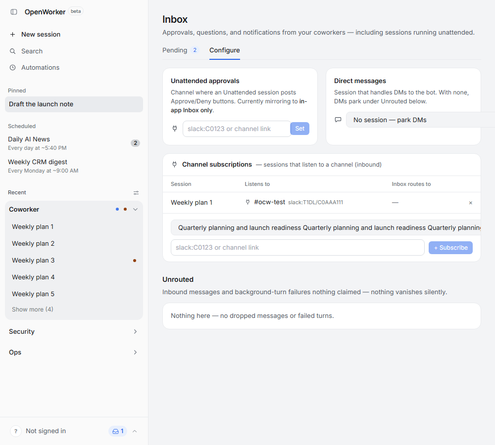
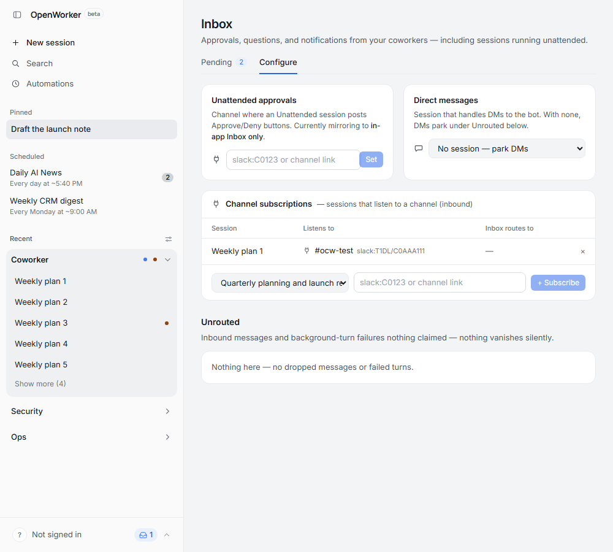

# Inbox Configure: long session-title layout

Baseline: upstream `ddb8b361bd5889703a429af8beaa804554bd858a`.

These are actual Chromium application screenshots on Windows, with the same 1000×900 viewport and synthetic API fixtures. Both session lists contain a long title made by repeating “Quarterly planning and launch readiness” six times. The subscription picker shows that title; the DM picker displays its fixture's no-session state. A long available option increases native-select intrinsic width even when that option is not currently selected.

The before capture uses the original application source. The after capture uses the two-line source patch: `min-w-0` on the flexible DM select, and `w-56 max-w-full` on the subscription select. No screenshot was edited and no runtime CSS override was used for the after image.

| Measurement | Before | After |
| --- | --- | --- |
| DM field right edge / card right edge | 2249 / 972 px | 955 / 972 px |
| Subscription field right edge / card right edge | 1895 / 972 px | 569 / 972 px |

The shipping browser regressions cover both selects at 1000px and 1280px, and check that the full option title and selection value remain available. Both cases fail on the baseline's card-boundary assertions and pass with the patch. Capturing the images is a separate local diagnostic; that helper is not part of the product PR.

The API and WebSockets use the repository's hermetic Playwright fixtures. These images demonstrate real browser layout; they do not claim a live Python-server or native Tauri test. Chromium is supplied by Playwright 1.61.1; Node is v24.17.0. The raw geometry is in the JSON files beside these images.

| Before | After |
| --- | --- |
|  |  |
