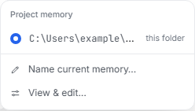
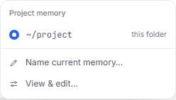

# Windows project-label comparison

PR: https://github.com/andrewyng/openworker/pull/826

The actual Chromium application renders a synthetic project-menu response for the same folder in both captures. The response's display fields were computed on native Windows by executing `project_label` from the tested upstream base `5e3d726` and PR head `d86b250c0b88e2949c5442ebd8a61c7fb73b6102` with the explicit synthetic home `C:\Users\example` and folder `C:\Users\example\project`.

`inputs.json` records those helper outputs. The before label retains the absolute path; after it is `~/project`. The key and full path are unchanged. The GUI code, viewport (1280×800), session fixture and menu state are identical. The screenshots are actual browser captures, not an edited mockup; the API response is mocked, so this is not a live Python-server or native Tauri integration test.

The capture check opened the session's Attach → Project memory menu, asserted the exact label and captured the viewport and menu in each state. Result: `1 passed (11.9s)` in Chromium with one worker and no retries.

| Before | After |
| --- | --- |
|  |  |

Full viewport captures: [before](before.png), [after](after.png).
