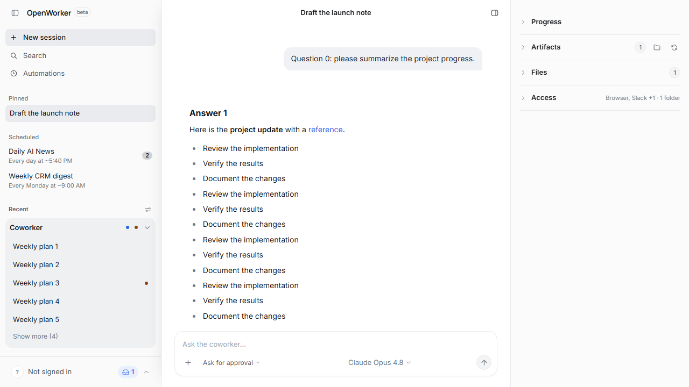

# Transcript rendering evidence

Windows / Chromium / Vite development build. The real GUI uses the repository's
hermetic API/WebSocket fixtures, with 200 synthetic messages (100 assistant
Markdown answers containing headings, lists, a table and a code block).

Open Settings, then choose Back to app. Collect PerformanceObserver `longtask`
entries through two seconds after all 100 assistant bubbles are present. Repeat
three times in one browser session. No CPU throttling. These measurements include
mount, parse and layout work; they are not a production-build latency guarantee.

Baseline: upstream commit `7bac273885d77f5794416ba7da5ad4ab4ceafd5f`.
After: the Markdown/BubbleMeta memoization and shared Intl formatter patch.

| Run | Before long tasks | Before total ms | After long tasks | After total ms |
| --- | ---: | ---: | ---: | ---: |
| 1 | 2 | 1104 | 1 | 737 |
| 2 | 3 | 1448 | 1 | 621 |
| 3 | 5 | 2204 | 1 | 686 |

Median total time spent in long tasks: **1448 -> 686 ms** (about 53% lower).
The remaining first render is still a long task. This change avoids repeated
parsing on parent updates; it does not virtualize the transcript.

The regression tests independently establish deterministic work counts: with 20
messages, an unchanged parent rerender performs **10 -> 0 additional Markdown
parses** and **40 -> 0 additional timestamp formatting operations**. Editing one
assistant answer performs exactly one additional parse.

Screenshots show the same first viewport after returning to the conversation;
the visual result is intentionally unchanged. Use the raw JSON above for timings.

| Before | After |
| --- | --- |
|  |  |

## Reproduce

Copy `transcript-perf-evidence.spec.ts` into `surfaces/gui/e2e/` in the checkout
under test. In `surfaces/gui`, install dependencies (`npm ci`) and Playwright
Chromium (`npx playwright install chromium`). Set `PERF_LABEL` to `before` or
`after`, then run `npx playwright test transcript-perf-evidence.spec.ts --workers=1`.
The harness writes screenshots/JSON in the current directory. Remove the temporary
spec when finished. It uses only synthetic fixture data and no model calls.

Unit coverage is committed with the implementation in
`src/components/Transcript.rerender.test.tsx`; run `npm test` and `npx tsc --noEmit`.

The shared formatters capture the system locale/timezone when the GUI module
loads. If the OS timezone changes while the app is open, reload to pick it up.
Normal DST transitions within that timezone remain handled by Intl.
